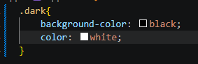
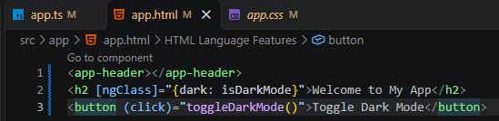

# Angular parte 2

## 10. Constructores

Así de sencillo es el metodo constructor

## 11. Models

La razon de los models es que cuando inicializas un constructor a veces necesitas un tipo de objeto como en este caso los product, pero en este caso solo esta infiriendo los tipos y son datos no estructurados

por lo cual se necesita para poder tipar esos objetos, hacer un modelo

ese es la sintaxis basica para las interfaces 

## 12. ngClass
La directiva ngClass nos permite crear clases dinamicas y dar estilos a los proyectos segun se cumplan algunas condiciones

primero se importa NgClass.

ahora para usar el ngClass se usara de ejemplo hacer una etiqueta que cambie a modo oscuro, se crea el boolean isDarkMode, despues la funcion toggleDarkMode.

el estilo cambia a la clase que se da en css con la siguientes propiedades  

ahora en la etiqueta h2 se coloca el ngClass y la propiedad de css que cambia y la propiedad ts que evalua {css: ts}.

para disparar el evento se configura un boton que al hacer click ejecute el metodo toggleDarkMode definido en el ts
